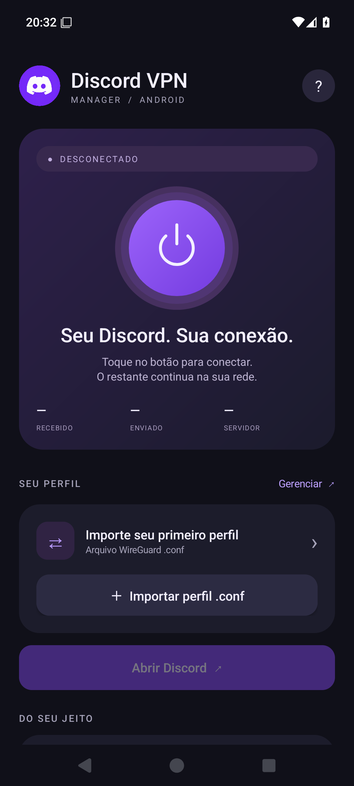

# Discord VPN Manager — Android

Aplicativo Java nativo, Android 8+, pacote `com.discordvpn.manager`.

VPN por aplicativo para o Discord oficial, com importação de perfis WireGuard, armazenamento criptografado e restauração opcional após reiniciar o Android.

- Mesmo nome e ícone do Manager do Windows.
- Somente `com.discord` entra na VPN.
- Notificação persistente para desconectar.
- Opção **Iniciar com o Android** e suporte a **VPN sempre ativa**.
- Sem perfis ou chaves de usuários no repositório.

Instalação e uso: [guia](COMO-INSTALAR-ANDROID.md). Detalhes dos testes: [validação](VALIDACAO.md).

<details><summary>Interface</summary></details>

O workflow Android checks executa testes, lint e gera um APK de teste a cada alteração. O APK de teste usa outra assinatura e não atualiza diretamente a versão pessoal de release. As atualizações da versão pessoal precisam manter a chave de assinatura original, preservada fora do GitHub.

## Compilar

Instale JDK 17 ou 21 e Android SDK com plataforma 35. Configure `ANDROID_HOME` ou um `local.properties` com `sdk.dir`.

```powershell
.\gradlew.bat :app:assembleDebug
.\gradlew.bat :app:testReleaseUnitTest :app:lintRelease
```

O projeto não contém chaves privadas, perfis do usuário, senha de assinatura ou o keystore da versão entregue.
Para gerar um release assinado, crie seu próprio keystore em `keystore/discord-vpn.jks`, alias `discordvpn`, e um arquivo `signing.properties` com `storePassword` e `keyPassword`. Depois execute `:app:assembleRelease`. Uma assinatura diferente não pode atualizar o APK pessoal já entregue sem desinstalá-lo.

## Estrutura

- `MainActivity`: interface, consentimento de VPN e importação via seletor do Android.
- `ProfilePolicy`: remove as regras de aplicativos do perfil importado e inclui exclusivamente `com.discord`.
- `Vault`: perfis criptografados com AES-GCM; chave no Android Keystore, sem backup.
- `TunnelService`: serviço em primeiro plano com WireGuard GoBackend e notificação para desconectar.
- `BootReceiver`: restaura o último perfil quando o usuário ativa a opção de iniciar com o Android.
- `ManagerApp`: backend compartilhado e callback de VPN sempre ativa.

O módulo `probe` é uma fixture exclusiva de testes que reserva o pacote `com.discord` no emulador. **Não instale a fixture no celular pessoal e não a distribua como Discord.** Somente o APK do módulo `app` é o produto.

O teste de integração requer um emulador descartável, a fixture, a permissão ACTIVATE_VPN autorizada e o app em primeiro plano. Usa chaves geradas na hora e o endereço de documentação 192.0.2.1; testa o ciclo de vida e a regra por app, sem afirmar conectividade com um provedor real.

Veja também COMO-INSTALAR-ANDROID.md e VALIDACAO.md.
